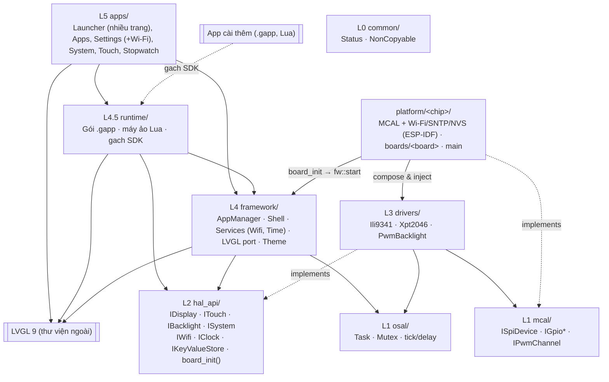

# Kiến trúc gach-os

## 1. Các tầng



| Tầng | Thư mục | Trách nhiệm | Biết về chip? |
| :--- | :--- | :--- | :---: |
| L5 apps | `src/apps` | Ứng dụng tích hợp, chỉ dùng `fw::`, `runtime::` (API public) + LVGL | ❌ |
| L4.5 runtime | `src/runtime` | Cài/gỡ gói `.gapp`, máy ảo Lua (arena RAM riêng), bindings gach SDK | ❌ |
| L4 framework | `src/framework` | Vòng đời app, back-stack, system UI, dịch vụ hệ thống, cầu LVGL | ❌ |
| L3 drivers | `src/drivers` | Driver IC (panel, touch, backlight) trên MCAL contract | ❌ |
| L2 hal_api | `src/hal_api` | Contract thiết bị theo lớp (display/touch/...) + điểm DI `board_init()` | ❌ |
| L1 mcal / osal | `src/mcal`, `src/osal` | Contract ngoại vi (SPI/GPIO/PWM) và RTOS | ❌ (osal/port: ✅) |
| L0 common | `src/common` | Kiểu dùng chung | ❌ |
| platform | `platform/<chip>` | Hiện thực MCAL bằng SDK chip, board composition, entry point, build | ✅ |

## 2. Ma trận phụ thuộc (Layer Matrix)

Nguồn sự thật: [`tools/layer_matrix.json`](../tools/layer_matrix.json). In lại bảng: `python3 tools/layer_check.py --print-matrix`.

| From \ To | std | common | mcal | osal | hal_api | drivers | framework | runtime | apps | lvgl | lua | vendor |
| :--- | :---: | :---: | :---: | :---: | :---: | :---: | :---: | :---: | :---: | :---: | :---: | :---: |
| **common** | ✅ | ✅ | ❌ | ❌ | ❌ | ❌ | ❌ | ❌ | ❌ | ❌ | ❌ | ❌ |
| **mcal** | ✅ | ✅ | ✅ | ❌ | ❌ | ❌ | ❌ | ❌ | ❌ | ❌ | ❌ | ❌ |
| **osal** | ✅ | ✅ | ❌ | ✅ | ❌ | ❌ | ❌ | ❌ | ❌ | ❌ | ❌ | ❌ |
| **osal_port** | ✅ | ✅ | ❌ | ✅ | ❌ | ❌ | ❌ | ❌ | ❌ | ❌ | ❌ | ✅ |
| **hal_api** | ✅ | ✅ | ❌ | ❌ | ✅ | ❌ | ❌ | ❌ | ❌ | ❌ | ❌ | ❌ |
| **drivers** | ✅ | ✅ | ✅ | ✅ | ✅ | ✅ | ❌ | ❌ | ❌ | ❌ | ❌ | ❌ |
| **framework** | ✅ | ✅ | ❌ | ✅ | ✅ | ❌ | ✅ | ❌ | ❌ | ✅ | ❌ | ❌ |
| **framework_public** | ✅ | ✅ | ❌ | ❌ | ❌ | ❌ | ✅ | ❌ | ❌ | ✅ | ❌ | ❌ |
| **runtime** | ✅ | ✅ | ❌ | ✅ | ✅ | ❌ | ✅ | ✅ | ❌ | ✅ | ✅ | ❌ |
| **runtime_public** | ✅ | ✅ | ❌ | ❌ | ❌ | ❌ | ❌ | ✅ | ❌ | ❌ | ❌ | ❌ |
| **apps** | ✅ | ✅ | ❌ | ❌ | ❌ | ❌ | ✅ | ✅ | ✅ | ✅ | ❌ | ❌ |
| **platform** | ✅ | ✅ | ✅ | ✅ | ✅ | ✅ | ✅ | ✅ | ✅ | ✅ | ✅ | ✅ |

`framework_public` / `runtime_public` = header public của tầng đó: không được lộ HAL/OSAL/Lua để app không thể chạm phần cứng hay máy ảo gián tiếp. Header Lua chỉ được include trong `src/runtime/src`.

### Ba lớp cưỡng chế

1. **Static check** – `tools/layer_check.py` (chạy tự động trong `./build.sh` và CI): kiểm tra mọi `#include` theo ma trận + chặn mẫu cấm (`new/malloc`, `std::vector`, `throw`, `dynamic_cast`, `sprintf`...).
2. **Build system** – mỗi tầng là một ESP-IDF component; `REQUIRES/PRIV_REQUIRES` phản chiếu đúng ma trận nên include sai tầng không có trong include path → lỗi biên dịch. Ví dụ `framework` để `hal_api` ở `PRIV_REQUIRES` nên `apps` không thấy HAL.
3. **Type system** – app chỉ nhận `fw::Context` (AppManager + Services). `fw::Services` trả `fw::DeviceInfo` thay vì kiểu HAL.

> ESP-IDF tự thêm "common requirements" (freertos, esp_log...) vào mọi component nên lớp 2 không chặn được include SDK — lớp 1 bù đúng lỗ hổng này.

## 3. Luồng khởi động

```
app_main()                                   platform/esp32/main/main.cpp
 ├─ hal::board_init()                        boards/<board>/board/src/board.cpp
 │   ├─ MCAL: SPI bus/device, GPIO, LEDC     components/esp32_mcal
 │   └─ Drivers: Ili9341, Xpt2046, PwmBacklight (inject MCAL)
 ├─ apps::register_builtin_apps(fw::app_manager())
 └─ fw::start(devices)                       tạo UI task (12 KiB) rồi chờ semaphore (timeout 5 s)
     └─ [UI task] dưới UI lock:
         ├─ display.init(), touch.init()
         ├─ LvglPort: lv_display (partial 24 KiB) + lv_indev + tick = osal::tick_ms
         ├─ Shell: status bar | content | nav bar (Back, Home)
         ├─ AppManager.start() → mở Launcher
         ├─ vẽ khung đầu → bật backlight → give semaphore (fw::start trả kết quả)
         └─ vòng lv_timer_handler()
```

> Mọi lời gọi LVGL (kể cả khởi tạo) chỉ diễn ra trong UI task. Task khác muốn chạm LVGL phải giữ `fw::UiLock`.

## 4. Mạng & thời gian

```
App Wi-Fi ──connect(ssid, pass, remember)──► fw::WifiService ──► hal::IWifi (Esp32Wifi, không chặn)
                                                  ▲ poll() mỗi 500 ms (UI task)
                                                  │ cạnh lên CONNECTED
                                                  ├─► lưu SSID/mật khẩu vào hal::IKeyValueStore (NVS)
                                                  └─► fw::TimeService::on_network_up()
                                                         └─► hal::IClock::start_sync("time.google.com")  (SNTP, đồng bộ lại mỗi giờ)
Shell / app ◄── fw::TimeService::now(): UTC + múi giờ (mặc định UTC+7, lưu NVS) → fw::DateTime
```

- Mọi thao tác mạng là **bất đồng bộ + polling**: UI không bao giờ bị chặn; HAL Wi-Fi tự đảm bảo thread-safe (event task ↔ UI task).
- Boot: `WifiService::start()` tự kết nối lại mạng đã lưu sau khi khung hình đầu đã hiển thị.
- Chưa đồng bộ NTP → status bar hiển thị `--:--` (không hiển thị giờ sai).
- Chuyển epoch → ngày giờ bằng thuật toán thuần (`fw::epoch_to_datetime`), không phụ thuộc libc/TZ của chip.

## 5. App cài thêm (runtime)

```
Thẻ SD: install/*.gapp ──(boot hoặc app "Apps")──► kiểm tra manifest ─► giải nén ─► apps/<id>/
                                                                                      │ đăng ký slot ScriptApp
Launcher ──launch──► ScriptApp (fw::App, exclusive) ──► ScriptHost: lua_newstate trên arena 64 KiB
                                                          ├─ gach.ui / timer / sys / storage / app
                                                          ├─ handle số nguyên ↔ lv_obj_t* (không lộ con trỏ)
                                                          ├─ ngân sách 500 ms/lần gọi (hook đếm lệnh)
                                                          └─ lỗi ⇒ màn hình "App error", đóng VM, OS vẫn chạy
```

- **Gói** = tar ustar không nén + `manifest.ini`; chặn đường dẫn tuyệt đối/`..` (zip-slip).
- **Bộ nhớ**: Lua chỉ cấp phát trong arena do board giao (`hal::Devices::app_arena`, board có PSRAM có thể cấp lớn hơn); đóng app = reset arena, không rò rỉ.
- **Exclusive**: chỉ một máy ảo ⇒ mở app script khác sẽ đóng app script đang nằm trong back-stack (`fw::AppInfo::exclusive`).
- **Hợp đồng ổn định**: app chỉ thấy gach SDK (version trong `runtime/sdk_version.hpp`), không thấy LVGL ⇒ nâng LVGL/đổi chip không làm vỡ app trên kho.
- Đặc tả cho người viết app: [docs/sdk.md](sdk.md).

## 6. Mô hình ứng dụng

- `fw::App` ≈ Activity của Android: `on_create(p_root) → on_resume ↔ on_pause → on_destroy`, `on_back()` trả `true` nếu tự xử lý.
- Back-stack tối đa `config::MAX_APP_STACK` (gồm Home). `launch()` app đã có trong stack sẽ quay về app đó.
- App được cấp phát tĩnh, đăng ký trong `src/apps/src/builtin_apps.cpp`. `AppInfo::show_in_launcher = false` để ẩn khỏi màn hình chính (VD: Wi-Fi, mở từ Settings).
- Launcher chia trang 4×2, vuốt ngang (`lv_tileview`). Để tiết kiệm RAM LVGL, lúc đứng yên chỉ giữ icon của trang đang xem, khi vuốt mới dựng thêm trang đích, và khi bị app khác che thì giải phóng toàn bộ icon.

### Thêm app mới

1. `src/apps/src/foo_app.hpp/.cpp` kế thừa `fw::App`, khai báo `constexpr fw::AppInfo`.
2. Thêm instance tĩnh vào mảng `s_apps` trong `builtin_apps.cpp`, thêm `.cpp` vào `src/apps/CMakeLists.txt`.
3. `./build.sh` (layer check tự chạy).

## 7. Port sang chip / board mới

| Việc | Chạm vào | Không chạm |
| :--- | :--- | :--- |
| Board mới cùng họ ESP32 (VD: ESP32-S3 + ST7789) | `platform/esp32/boards/<board>/` (board.env, sdkconfig.defaults, `board/`), driver mới trong `src/drivers` nếu IC mới | framework, apps |
| Họ chip mới (VD: STM32, RP2040) | `platform/<chip>/`: MCAL impl, `build.sh`, entry point, board; osal port nếu không phải FreeRTOS | `src/` (trừ thêm port osal) |
| Màn hình kích thước khác | `Ili9341Config`/driver mới + `board_config.hpp` | Shell/Launcher tự co giãn theo `IDisplay::width/height` |

Hợp đồng tối thiểu cho platform mới: hiện thực `mcal::*` cần dùng, `hal::ISystem`, `hal::board_init()`, OSAL port, và script `platform/<chip>/build.sh <board> <action>`.
